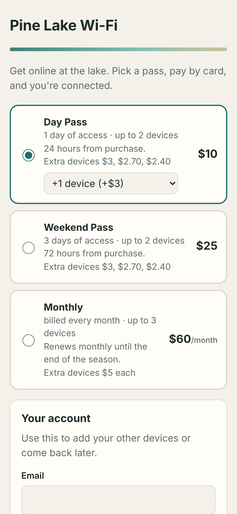
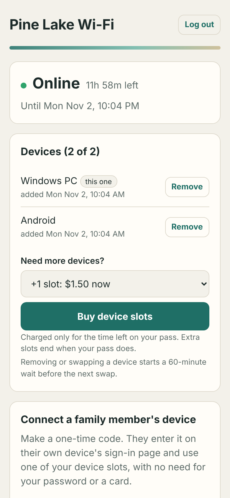
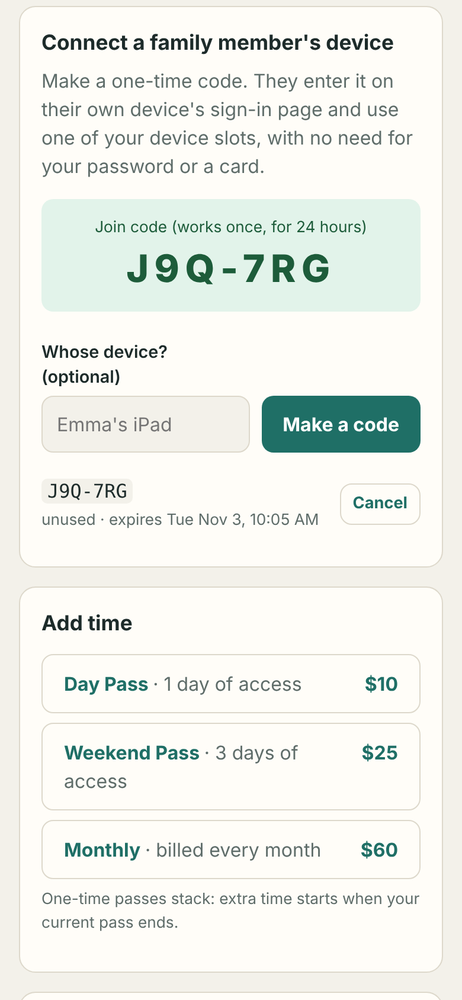
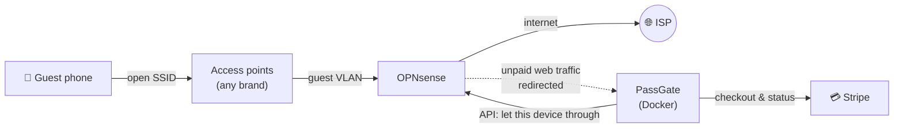
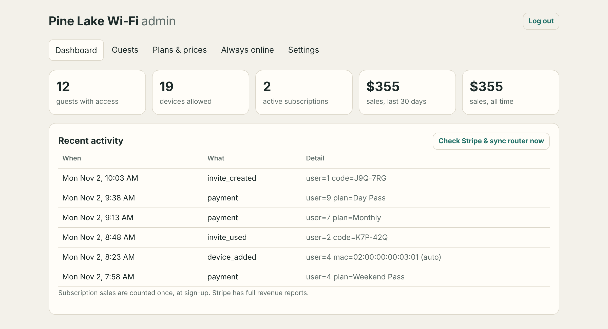
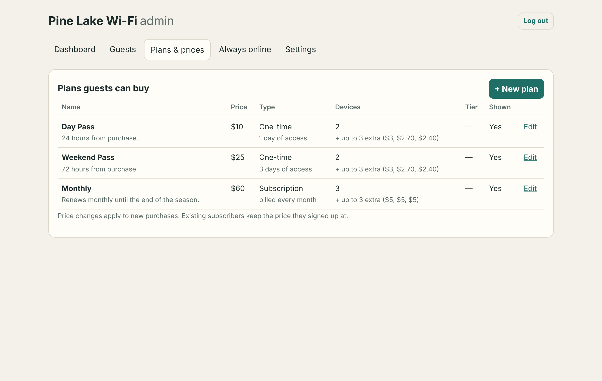
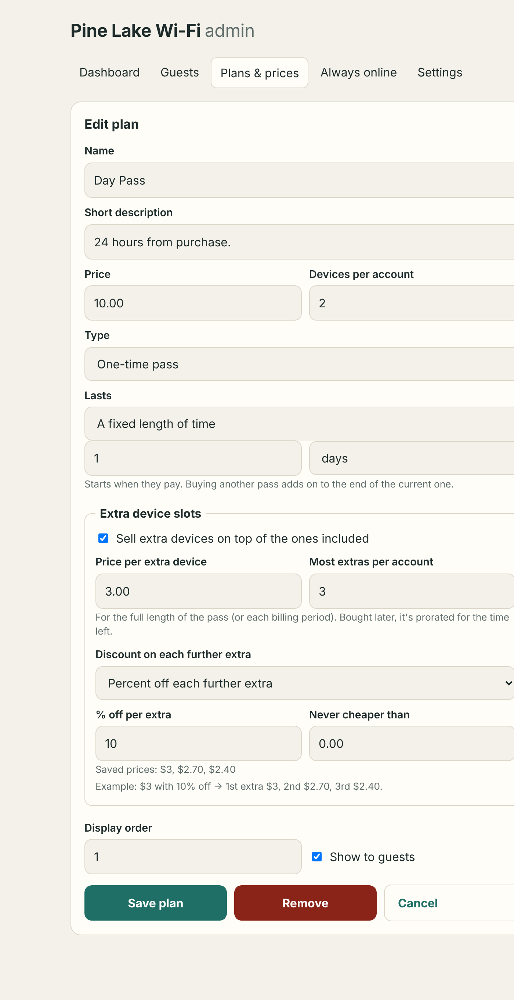
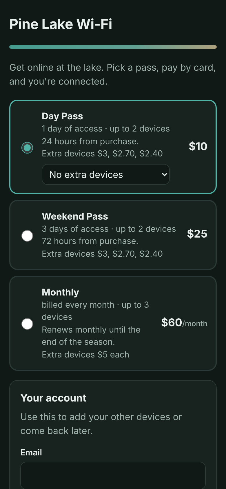

<div align="center">


# PassGate

**Sell Wi-Fi passes with Stripe. Self-hosted, open source, and it works with the access points you already have.**

A captive portal for campgrounds, lakes, cabins, RV parks, marinas, and anywhere else you share an internet connection with paying guests.

[](https://github.com/Axon07/Passgate/actions/workflows/ci.yml)
[](https://github.com/Axon07/Passgate/releases)
[](LICENSE)

[](https://github.com/Axon07/Passgate/pkgs/container/passgate)


[Features](#-features) · [How it works](#-how-it-works) · [Quick start](#-quick-start) · [Network guide](docs/opnsense-setup.md) · [FAQ](#-faq)

<br>

 &nbsp;
 &nbsp;


</div>

---

Guests join your open Wi-Fi, the sign-in page pops up, they pick a **day, weekend or monthly pass**, pay by card, and they're online. **No vouchers to hand out and nobody has to be on site.** Money goes straight to your Stripe account with no platform fee, and everything runs in one small Docker container next to your firewall.

## ✨ Features

<table>
<tr>
<td width="50%" valign="top">

### 💳 Selling access
- **Passes you design:** hours, days, "until end of season", or **monthly subscriptions** that stop billing on the last day of your season
- **Passes stack:** a day pass bought on top of a weekend pass adds time
- **Extra device slots** at checkout or later, **prorated** for the time left
- **Optional volume discount:** percent or dollar amount off each further slot
- Refunds and cancellations from your Stripe dashboard are picked up automatically

</td>
<td width="50%" valign="top">

### 📱 Guests and devices
- **Email accounts** with a per-plan device limit
- Guests add their laptop by logging in on it, and **swap devices themselves**
- **Join codes:** a parent makes a code and the kids' phones join the pass, with no password or card needed
- **TVs and consoles** added by MAC address
- Access **follows each device** when its IP changes

</td>
</tr>
<tr>
<td valign="top">

### 🛠️ For the owner
- **First-run setup wizard**, then everything is changed in the browser
- Dashboard, guest lookup, comp passes, password resets, blocking
- **Per-guest device limits** and an **always-online** list for your own gear
- **Swap cooldown** so one login can't be passed around the campsite
- Optional **speed tiers** per plan through OPNsense's shaper

</td>
<td valign="top">

### 🧱 Built for the middle of nowhere
- **Works behind any ISP, CGNAT included:** no port forwarding or webhooks needed
- **Fails closed:** if the server is off, guests get nothing (not free internet)
- **Any access points:** UniFi, TP-Link, OpenWrt, HaLow bridges and others
- One Python process + SQLite. Upgrades migrate the database on start
- MIT licensed. Your data stays on your hardware

</td>
</tr>
</table>

## 🧭 How it works



1. A new phone joins the open network. OPNsense blocks it and sends its web traffic to PassGate, so the **"Sign in to network"** sheet pops up.
2. The guest picks a plan and makes an account. PassGate opens the gate for a few minutes so the phone can reach **Stripe Checkout**.
3. Payment succeeds, and PassGate adds the device to an OPNsense alias. **The guest is online.**
4. Every 30 seconds PassGate re-syncs the allow-list. It follows devices when their IP changes, removes expired passes, and rebuilds the list after a router reboot. Every 5 minutes it asks Stripe about renewals, cancellations and checkouts that never came back.

PassGate only decides **who** gets through; the firewall enforces it. Guest traffic never passes through the container.

## 🖼️ Screenshots

<table>
<tr>
<td><p align="center"><sub>Owner dashboard</sub></p></td>
<td><p align="center"><sub>Plans &amp; prices</sub></p></td>
</tr>
<tr>
<td><p align="center"><sub>Plan editor: extra slots and discounts</sub></p></td>
<td align="center"><p align="center"><sub>Guest portal follows the phone's dark mode</sub></p></td>
</tr>
</table>

## 🚀 Quick start

> **Try it first, no router needed:**
> ```bash
> docker run -d --name passgate-try -p 8090:80 -p 8091:8081 -v passgate-try:/data ghcr.io/axon07/passgate:latest
> ```
> Open `http://localhost:8091/setup`, then the guest page on port 8090. In dry-run mode payments work (use a Stripe test key) but nobody is actually let online.

**For real:**

1. **Set up the network.** Follow the **[network guide](docs/opnsense-setup.md)**: guest VLAN, alias, firewall and NAT rules, API key, and a DNS name for the portal.
2. **Run the container** on any Docker host attached to the small services network (VLAN 51) behind OPNsense. Set `parent` in `docker-compose.yml` to that host's VLAN 51 interface (e.g. `eth0.51`), then:

   ```bash
   mkdir passgate && cd passgate && curl -fsSLO https://raw.githubusercontent.com/Axon07/Passgate/main/docker-compose.yml && docker compose up -d
   ```

   The image (`ghcr.io/axon07/passgate`) is built for amd64 and arm64, so it runs on a Raspberry Pi too. **Unraid** users can add it from a template (see below). Plain Docker and Proxmox examples are in the [network guide](docs/opnsense-setup.md#1-hardware-where-opnsense-and-passgate-run).

3. **Open the admin page** at `http://<OPNsense WAN IP>:8081/setup`. Set your network name, portal address and admin password.
4. **Set your prices** under *Plans & prices*. Three starter plans are created for you.
5. In **Settings**, add your Stripe key and OPNsense API details, switch *Router* to OPNsense, and press **Test**.
6. Buy a pass on your phone with Stripe's test card `4242 4242 4242 4242`. When it works, swap in your live key. 🎉

<details>
<summary><b>Unraid</b></summary>

Until PassGate is listed in Community Applications, add its template by hand. In the Unraid terminal, run:

```bash
wget -qO /boot/config/plugins/dockerMan/templates-user/my-PassGate.xml https://raw.githubusercontent.com/Axon07/Passgate/main/unraid/passgate.xml
```

then **Docker → Add Container → Template: PassGate**. The defaults run in bridge mode for trying it out. For real use, set **Network Type** to your services VLAN (e.g. `br0.51`) and a **Fixed IP** (e.g. `10.51.0.2`).
</details>

**Updating:** pull the new image and recreate the container (`docker compose pull && docker compose up -d`, or *Check for updates* in Unraid). Your data stays in the data folder, and the database upgrades itself on start.

## 📚 Guide

<details>
<summary><b>💳 Stripe setup</b></summary>

- Use a **secret key**, or a restricted key with write access to Checkout Sessions, Customers, Products, Subscriptions, Subscription Items and Billing Portal, plus read access to Balance for the test button.
- **Nothing to create in Stripe.** PassGate sends prices with each checkout, so you manage prices only in PassGate.
- Turn on the **Customer portal** (Stripe → Settings → Billing → Customer portal) so guests can cancel or update their card. The *Manage billing* button uses it.
- **Webhooks are optional.** They only help if Stripe can reach your portal, for example through a Cloudflare Tunnel. Endpoint: `https://your-public-name/stripe/webhook`. Events: `checkout.session.completed`, `customer.subscription.updated`, `customer.subscription.deleted`, `invoice.paid`. Paste the signing secret into Settings.
- Refunds and cancellations happen in the Stripe dashboard. PassGate picks them up within 5 minutes.

</details>

<details>
<summary><b>📱 Devices, limits and swapping</b></summary>

**How a device joins an account.** Guests never type a MAC. When a page is opened, PassGate asks OPNsense's ARP table which MAC is using that IP. The phone that pays becomes device 1, and logging in on another device adds it. OPNsense filters by IP, and every 30 seconds PassGate maps each registered MAC to its current IP.

**Device limit** = devices included + extra slots bought. Included devices come from the best active pass, or from a custom limit you set on the guest's admin page. A custom limit of 5 plus one bought slot means 6 devices.

**Hitting the limit.** The account page lists devices with *Swap for this device* buttons. If someone pays from a new device while full, the payment still goes through and they get the swap choice straight away, with no cooldown that time.

**Swap cooldown** (Settings, default 60 min, 0 = off). After removing or swapping a device, guests wait before the next swap. That makes sharing one login by swapping back and forth impractical. You can lift it per guest.

**A device that's already on someone else's account:**

| How it's added | Result |
|---|---|
| Logging in on the device itself | Moves to the new account (e.g. a kid's phone moving to their own account) |
| A guest typing in its MAC | Refused, so nobody can take a device by copying its MAC |
| The owner typing in its MAC | Moved, with a note |

**Adding by MAC** (TVs, consoles, streaming sticks). Guests can do this from their account page (you can turn it off), and the owner can from the admin page. It counts toward the limit. The MAC must be the one the device uses *on this network*, because phones and some TVs use a private MAC per Wi-Fi network.

**Always online.** Admin → *Always online*. These MACs get internet with no account or pass.

</details>

<details>
<summary><b>➕ Extra device slots and discounts</b></summary>

Off by default, and set per plan: *Plans → Edit → Extra device slots*.

- **Price per extra device** covers the plan's full length, or each billing period for subscriptions, up to *Most extras per account*.
- **Discount on each further extra** (optional): percent or fixed amount off each additional slot, never below *Never cheaper than*. For example, $3 with 10% off makes $3, $2.70, $2.40.
- **At checkout** guests pick "+1 / +2 / +3 devices" under the plan, and Stripe shows it as a second line.
- **Later**, *Buy device slots* charges only for the time left. Halfway through a weekend pass, a $3 slot costs $1.50. Stripe's minimum card charge of $0.50 applies.
  - On one-time passes, extras last until the guest's current access ends.
  - On subscriptions, the prorated amount covers the rest of this period, then the slot is added to the subscription at full price. PassGate reads extras back from Stripe, so removing the item there removes the slot.

</details>

<details>
<summary><b>👨‍👩‍👧 Join codes for families</b></summary>

On the account page, *Connect a family member's device* makes a one-time code like `K7P-42Q`, valid for 24 hours. On the other device, the sign-in page has *Have a join code?*

The device takes one of the account's slots and shows *"Connected through pa•••@example.com's pass"*. It **never gets the account itself**: no billing, device list or password. Ten wrong codes in an hour locks that device out for a while. A full account refuses the code with a clear message.

</details>

<details>
<summary><b>🐢 Speed limits</b></summary>

Speeds are enforced by the router. PassGate can't do it because guest traffic never passes through it.

- **One cap for everyone:** no PassGate setup needed. Add a shaper pipe with a per-IP mask in OPNsense ([guide](docs/opnsense-setup.md#8-speed-limits-optional-recommended)).
- **Different speeds per plan:** in Settings → *Speed tiers*, list tiers as `Name = alias` (e.g. `Basic = paid_basic`, `Premium = paid_premium`) and pick a tier on each plan. PassGate puts each paid device in the main alias (internet on/off) **and** its tier alias, which your shaper rules match. Limits are per device.

</details>

<details>
<summary><b>⚙️ Ports, data and other details</b></summary>

| Port | What | Who should reach it |
|------|------|---------------------|
| `80` | Guest portal, `/stripe/webhook`, `/api/captive` | guests |
| `8081` | Admin dashboard | only you, via the OPNsense WAN port-forward. It refuses the guest subnet. |

- **Data** lives in `/data/passgate.db` (SQLite). Back up that folder.
- **Payment window:** unpaid devices get a few minutes of internet (default 15) to reach Stripe's page, limited to a few tries per device per day.
- **Time zone and season end** are in Settings. Subscriptions created while a season end is set get `cancel_at` set to that date in Stripe.

</details>

## ❓ FAQ

<details>
<summary><b>Do I need Ubiquiti, or any particular access points?</b></summary>

No. Any access point that can put guests on a VLAN works: UniFi, TP-Link Omada, OpenWrt, MikroTik, long-range point-to-multipoint links, HaLow bridges. Turn off the AP's own guest portal and turn on client isolation.
</details>

<details>
<summary><b>Does it work if my ISP uses CGNAT, or I can't open ports?</b></summary>

Yes. Many ISPs put customers behind CGNAT, so nothing on the internet can reach your server. PassGate only makes outgoing calls to Stripe and checks payment status itself, so you don't need webhooks or port forwarding.
</details>

<details>
<summary><b>Can people get around it?</b></summary>

MAC addresses are visible over the air and can be copied. That's true of **every** open-network captive portal, commercial ones included. Someone who copies a paying guest's MAC can use their pass while that guest is offline. Client isolation on your APs and a short always-online list help. The complete fix is per-user Wi-Fi credentials (WPA2/3-Enterprise), which is outside PassGate's scope.
</details>

<details>
<summary><b>Can guests use Apple Pay or Google Pay?</b></summary>

Usually not inside the pop-up sign-in sheet on phones, which is a limitation of those mini-browsers. Cards always work, and guests can open the portal address in their normal browser to use wallet payments.
</details>

<details>
<summary><b>What about pfSense, MikroTik or OpenWrt as the firewall?</b></summary>

PassGate ships with an OPNsense driver. Router support lives in [`app/gateway.py`](app/gateway.py): a driver needs list / allow / revoke on an allow-list, plus an IP→MAC lookup. Pull requests for more drivers are very welcome.
</details>

<details>
<summary><b>Is reselling internet allowed?</b></summary>

That depends on your internet plan and where you are. Check that your provider's terms allow resale. Some providers and satellite services require a business plan, and some regions require registering as a reseller.
</details>

## 🧑‍💻 Development

```bash
pip install -r requirements.txt pytest && pytest -q
```

The test suite runs the full guest and owner flows against a fake Stripe and a dry-run router.

| File | What it does |
|---|---|
| `app/portal.py` | Guest pages: plans, checkout, account, join codes |
| `app/admin.py` | Owner dashboard and settings |
| `app/billing.py` | Stripe checkout, fulfilment, subscription sync |
| `app/extras.py` | Extra device slot pricing, discounts, proration |
| `app/access.py` | Who's allowed online, devices, invites, the sync loop |
| `app/gateway.py` | Router drivers (OPNsense, dry-run) |
| `app/db.py` | SQLite schema, settings, migrations |

## 🤝 Contributing

Issues and pull requests are welcome, especially new router drivers, translations, and reports from real deployments. Please include a test for any change in behaviour.

## 📄 License

[MIT](LICENSE) © 2026 PassGate contributors
